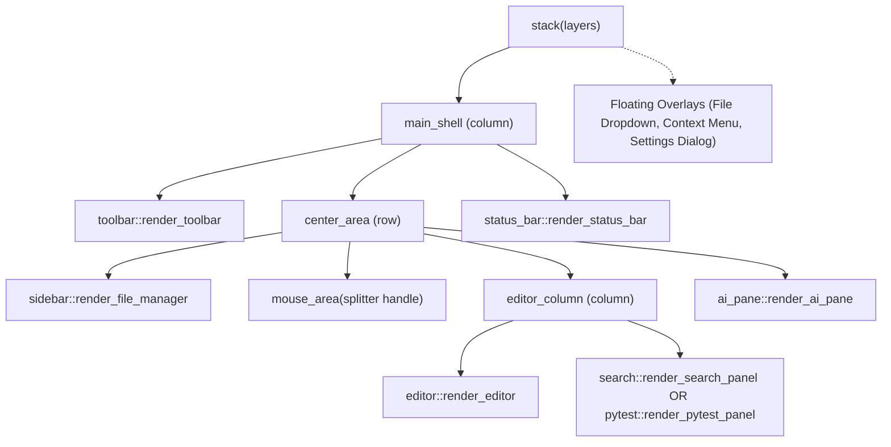

# Iced TEA UI & Tokio Streaming Architecture in Lide

This skill covers the presentation architecture in `crates/app-iced`: The Elm Architecture (TEA), in-memory TrueType font embedding, widget layouts, zero-shift caret overlays, lock-free mouse tracking, and native Tokio streaming tasks.

---

## 1. The Elm Architecture (TEA) State Transitions

In Iced, state mutation and rendering are strictly separated into a deterministic cycle:
$$\text{State} \times \text{Message} \longrightarrow \text{State} \times \text{Task}\langle\text{Message}\rangle$$

1. **State (`LideApp`)**:
   - Unified in `LideApp` in `crates/app-iced/src/lib.rs`.
   - Holds the headless `EditorBuffer`, viewport metrics, active workspace path, file manager tree, outline items, active theme, and background task cancellation handles.
2. **Deterministic Commands (`EditorCommand`)**:
   - Every user interaction, keyboard shortcut, mouse click, or background stream chunk emits an `EditorCommand` enum variant.
   - Handled in `LideApp::update(&mut self, message: EditorCommand) -> Task<EditorCommand>`.
   - For headless TDD tests, `app.dispatch(cmd)` executes the deterministic update logic synchronously without requiring an event loop.
3. **Pure Function `view()`**:
   - `views::render_app(&self) -> Element<'_, EditorCommand>` is a pure function projection of state.
   - No state mutations occur during view construction.
4. **Subscriptions**:
   - Unified global listener in `subscriptions::app_subscriptions(&LideApp) -> Subscription<EditorCommand>`.
   - Listens to `iced::event::listen()` to capture mouse movement (`CursorMoved`) and keyboard input (`KeyPressed`).

---

## 2. In-Memory TrueType & Vector Font Embedding (`fonts.rs` & `icons.rs`)

To bypass Windows GDI, registry permission issues, and missing OS font files:

1. **In-Memory TrueType Bytes**:
   - Font binaries are embedded directly into the executable via `include_bytes!("../../../fonts/...")`:
     - JetBrains Mono (Medium, Bold, Italic, Bold-Italic)
     - Fira Code
     - Source Code Pro
     - Hack
   - Registered at application initialization:
     ```rust
     iced::application("Lide", LideApp::update, LideApp::view)
         .font(JETBRAINS_MONO_MEDIUM_BYTES)
         .font(JETBRAINS_MONO_BOLD_BYTES)
         .font(JETBRAINS_MONO_ITALIC_BYTES)
         .font(JETBRAINS_MONO_BOLD_ITALIC_BYTES)
         .default_font(FONT_JETBRAINS_MONO)
     ```
2. **Vector Icon Font (`lucide-icons`)**:
   - Standard monospace coding fonts lack modern IDE icons.
   - Powered by `lucide-icons` (`features = ["iced"]`), registering `LUCIDE_FONT_BYTES` at startup.
   - Rendered using `crate::icons::icon_colored(Icon::..., color)` into scalable vector glyphs that honor the active theme.

---

## 3. View Component Hierarchy & Modal Layering (`views/mod.rs`)

The main UI shell is structured into clean visual zones:



### Non-Shifting Floating Overlays (`stack`)
- Dropdown menus (File menu), file tree right-click context menus, and modal dialogs (Settings, Font picker) are stacked on top of `main_shell` using Iced `stack(layers)`.
- This ensures opening a menu never causes layout reflows or vertical shifts in the editor canvas.

---

## 4. Virtualized Viewport & Zero-Shift Caret Overlay (`views/editor.rs`)

### Virtualized Viewport Math
- Height in pixels divided by `line_height_px`:
  - `start_line = (scroll_offset_y / line_height_px).floor() as usize`
  - `visible_count = (viewport_height_px / line_height_px).ceil() as usize`
  - `top_spacer_height = start_line * line_height`
  - `bottom_spacer_height = (total_lines - end_line) * line_height`
- Clicking the bottom spacer triggers `EditorCommand::ClickEditorEmptySpace` (jumping cursor to end of document).

### Zero-Shift Caret Stack Overlay
To prevent cursor presence from distorting code indentation:
1. **Never inject cursor characters into the text stream**.
2. Render syntax-highlighted text into `code_row`.
3. If the row is active and has a cursor, render a stacked `caret_overlay`:
   ```rust
   let caret_bar = container(Space::new(Length::Fixed(2.5), Length::Fixed(caret_height)))
       .width(Length::Fixed(2.5))
       .height(Length::Fixed(caret_height))
       .style(move |_| container::Style {
           background: Some(theme.text_accent.into()),
           ..Default::default()
       });

   let caret_overlay = row![
       text(prefix_text)
           .size(font_size)
           .font(editor_font)
           .color(iced::Color::TRANSPARENT),
       caret_bar,
   ];

   stack(vec![
       container(code_row).width(Length::Fill).into(),
       container(caret_overlay).width(Length::Fill).into(),
   ])
   ```
4. Both layers use `width(Length::Fill)` within `stack` to ensure typing at line ends never clips the cursor.

---

## 5. Lock-Free Mouse Tracking & Column Placement

### Lock-Free Coordinate Storage (`subscriptions/mod.rs`)
- On `iced::mouse::Event::CursorMoved`, update `LAST_MOUSE_X` and `LAST_MOUSE_Y` using atomic `AtomicU32`:
  ```rust
  static LAST_MOUSE_X: AtomicU32 = AtomicU32::new(0);
  static LAST_MOUSE_Y: AtomicU32 = AtomicU32::new(0);

  pub fn update_last_mouse_pos(point: iced::Point) {
      LAST_MOUSE_X.store(point.x.to_bits(), Ordering::Relaxed);
      LAST_MOUSE_Y.store(point.y.to_bits(), Ordering::Relaxed);
  }
  ```
- Exposes `set_mock_mouse_pos(Point)` for deterministic headless testing.

### Column Resolution on Mouse Click (`ClickEditorLine`)
When clicking a line wrapped in `mouse_area`:
$$\text{code\_start\_x} = \text{sidebar\_width} + 4\text{px (splitter)} + \text{gutter\_width}$$
$$\text{rel\_x} = \max(0, \text{mouse\_x} - \text{code\_start\_x})$$
$$\text{col} = \min\left(\mathrm{round}\left(\frac{\text{rel\_x}}{\text{font\_size} \times 0.60}\right), \text{line\_len}\right)$$
- Gutter clicks clamp to column `0`.
- Clicks beyond line length clamp to `line_len`.

---

## 6. Keyboard Event Resolution (`subscriptions/keyboard.rs`)

`resolve_key_event(key, modified_key, modifiers, text)` uses strict priority order:
1. **Escape**: Unified `EditorCommand::Escape` dismissing open menus, dialogs, or active streams.
2. **Global Shortcuts** (`modifiers.command()`):
   - `Ctrl+S` -> Save active file & format
   - `Ctrl+Z` -> Undo, `Ctrl+Shift+Z` / `Ctrl+Y` -> Redo
   - `Ctrl+Shift+F` -> Toggle Find-in-Files
   - `Ctrl+Shift+T` -> Toggle Pytest panel
   - `Ctrl+I` -> Toggle AI Assistant panel
   - `Ctrl+B` -> Toggle File Manager sidebar
3. **Navigation Keys**: Arrow keys, Home, End, Enter (with auto-indent), Backspace, Tab (indent), Shift+Tab (dedent).
4. **Text Insertion**:
   - **Priority A (OS text)**: Checks `text: Option<&str>` for printable characters (respects CapsLock, Shift, dead keys, and international layouts).
   - **Priority B (`modified_key`)**: Fallback for shifted punctuation (e.g. `:`, `"`, `?`).
   - **Priority C (`key`)**: Raw character fallback with shift capitalization.

---

## 7. Interactive Draggable Splitter Handle

The File Manager sidebar uses an interactive resize splitter:
- Splitter width: `4px` with focused/subtle border hover highlights.
- `EditorCommand::StartResizeSidebar`: Sets `app.is_resizing_sidebar = true`.
- On `CursorMoved` while resizing: Dispatches `EditorCommand::ResizeSidebar(position.x)`.
- Updates `app.sidebar_width_px = new_width.clamp(140.0, 700.0)`.
- On `ButtonReleased(Left)`: Dispatches `EditorCommand::EndResizeSidebar`.

---

## 8. Native Tokio Async Streaming Tasks

Heavy background operations (AI token streams, Pytest output, Ripgrep search) run asynchronously:

```rust
EditorCommand::TriggerAiTask(task) => {
    if let Some(req) = self.prepare_ai_task_request(task) {
        let ai_engine = AiEngine::new(ai_engine::OllamaStreamingClient::default());
        let handle = ai_engine.start_stream(req);
        self.active_ai_cancel = Some(handle.cancel_sender());
        let mut rx = handle.rx;
        return Task::stream(iced::stream::channel(128, move |mut output| async move {
            use iced::futures::SinkExt;
            while let Some(event) = rx.recv().await {
                if output.send(EditorCommand::ReceiveAiStreamEvent(event)).await.is_err() {
                    break;
                }
            }
        }));
    }
    Task::none()
}
```

### Cooperative Task Cancellation
- `handle.cancel_sender()` stores a cloneable `watch::Sender<bool>` in `self.active_ai_cancel` or `self.active_pytest_cancel`.
- Pressing `Escape` or clicking Cancel sends `true` via `cancel_tx.send(true)`.
- The Tokio worker observes the cancellation flag and aborts process execution cleanly.

