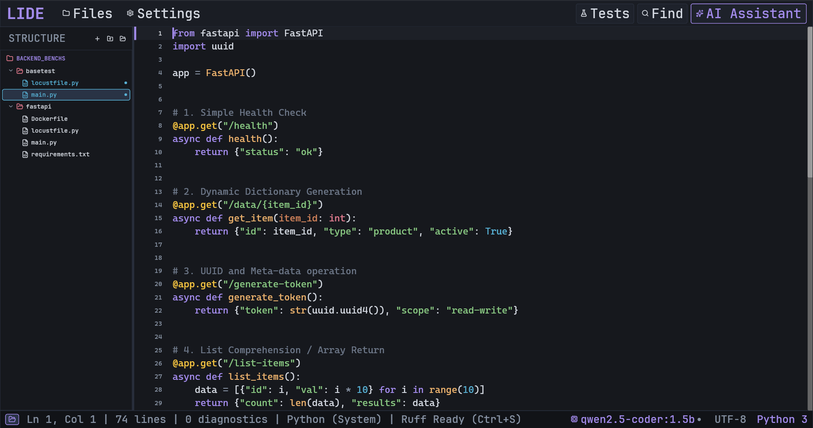
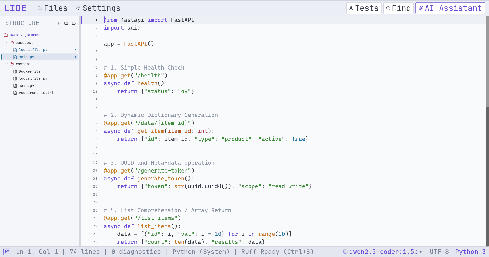
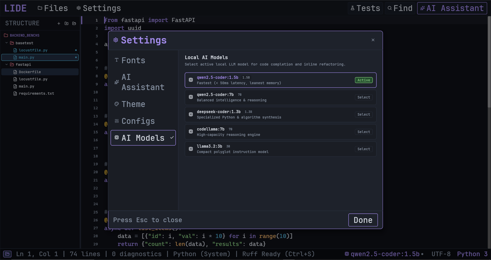

# Lide Editor

A lightweight, memory-lean, single-binary Python & polyglot IDE written in 100% pure Rust, powered by **[Iced](https://github.com/iced-rs/iced)** (The Elm Architecture) with embedded **Astral Ruff**, **Tree-sitter**, **Ripgrep**, and local AI assistance.

---

> **Note:** Lide is under active, rapid development and engineered with strict test-driven development (TDD).

---

## Visual Tour

### 1. Lide Original v1 — Dark Mode (Cerebral Night)
High-performance virtualized editor viewport with anti-fatigue deep slate canvas, warm apricot function anchors, cool amethyst control flow, and radiant gold decorators.



### 2. Lide Original v1 — Light Mode (Cerebral Day)
Soft, tinted background engineered to prevent pupil strain during daytime development while maintaining clean semantic separation across strings, numbers, and types.



### 3. Local-First AI Assistant & Open Models
AST-scoped prompt slicing connected directly to local Ollama open models (`qwen2.5-coder`, `deepseek-coder`, `llama3`, `codellama`, etc.) for private code completions, docstrings, and refactoring with zero cloud telemetry.



---

## Why Lide? (Rationale & Motivation)

Existing development environments like VS Code, PyCharm, and Neovim make distinct trade-offs:

1. **Memory & Runtime Overhead:** Modern IDEs frequently run on heavy runtime layers (Electron, Chromium, Node.js, JVM). They consume 1 GB to 3 GB of RAM, take seconds to start up, and rely on dozens of background processes communicating over IPC.
2. **Terminal vs. GUI Gap:** Terminal editors (Neovim, Helix) are fast and memory-efficient, but lack native GUI primitives for side-by-side test traceback navigation, interactive outline sidebars, and reactive token streaming without complex plugin configurations.
3. **External Daemon Latency:** Traditional editors invoke external formatters and linters via subprocesses or language server protocols, introducing round-trip latency on simple actions like format-on-save or file search.

### The Problem Lide Solves
Lide was engineered as a single-binary, native alternative:
- **Zero Web Technologies:** Written entirely in pure Rust, rendering natively through **Iced** using The Elm Architecture (TEA) and GPU/software rasterization—no web views, DOM reflows, or browser runtimes.
- **In-Process Python Tooling:** Directly embeds **Astral Ruff** (`ruff_python_parser`, `ruff_python_formatter`), **Tree-sitter**, and **Ripgrep** (`grep-searcher`) into the same executable. Parsing, formatting, and searching occur in-memory without IPC overhead or process startup latency.
- **Sub-50ms Cold Start & ~40 MB RAM:** Launches instantly and idles at a fraction of the memory footprint of Electron- or JVM-based editors.
- **Zero-Shift Caret Physics:** Carets are rendered as non-intrusive stacked overlays, eliminating cursor-induced indentation distortion and line jitter.
- **Local-First Privacy:** AI features connect directly to your local **Ollama** daemon, slicing only the enclosing function/class AST scope to minimize token usage and keep code private on-device.

---

## Comprehensive Feature Highlights

### 1. Editor Core & Typography Mechanics
- **B-Tree Rope Buffer:** Engineered on `ropey`, handling massive codebases with $O(\log N)$ edits and sub-microsecond line/column indexing.
- **Virtualized Viewport:** Renders only visible rows within the scroll window, delivering smooth 60–120 FPS scrolling even on 10,000+ line files.
- **Zero-Shift Caret Overlay:** Positions carets using an independent stacked layer (`views/editor.rs`) rather than injecting text glyphs, guaranteeing that code lines and indentation never jitter when active.
- **Lock-Free Atomic Mouse Tracking:** Updates cursor coordinates (`LAST_MOUSE_X`/`LAST_MOUSE_Y`) in sub-nanoseconds on `CursorMoved` with zero heap allocations and no unneeded TEA re-renders.
- **Accurate Click-to-Column Navigation:** Monospace character advance projection resolves exact line and column indices from mouse clicks, complete with gutter clamping to column 0 and line-end clamping.
- **Empty Space Navigation:** Clicking empty space below code (`ClickEditorEmptySpace`) jumps cursor directly to the end of the file.
- **Full OS Text & Shift Input Resolution:** Advanced keyboard dispatcher (`resolve_key_event`) prioritizes OS-provided text and `modified_key`, ensuring seamless uppercase typing, CapsLock, and shifted punctuation (`:`, `"`, `?`, `!`, `@`, `#`).
- **Python Smart Auto-Indentation:** Automatically preserves leading indentation and appends 4 PEP 8 spaces on colons (`:`) upon pressing `Enter`.
- **PEP 8 Block Indent & Dedent:** Indents or dedents the active line or block by 4 spaces via `Tab` and `Shift+Tab`.
- **Transactional Undo / Redo:** Full transaction history (`Ctrl+Z`, `Ctrl+Shift+Z` / `Ctrl+Y`) restoring exact buffer states and cursor coordinates.
- **Gutter Diagnostics & Line Highlights:** Displays active line background highlights, line numbers (toggleable), and diagnostic severity badges.
- **In-Memory Embedded Fonts:** Zero-network embedded TrueType fonts (`fonts.rs` via `include_bytes!`): **JetBrains Mono** (Medium, Bold, Italic, Bold-Italic), **Fira Code**, **Source Code Pro**, and **Hack**.
- **Vector Iconography:** Powered by embedded `lucide-icons` vector font matching IDE theme colors without bitmap distortion.

### 2. In-Process Python Intelligence
- **Incremental Syntax Highlighting:** Powered by `tree-sitter-python` for real-time lexical and syntactic token highlighting.
- **In-Process Astral Ruff AST Parser:** Embedded `ruff_python_parser` extracts syntax errors and linting diagnostics in microseconds without spawning background processes.
- **Ephemeral AST Outline Extraction:** Parses Python classes, functions, and methods into a live hierarchy and immediately drops the AST arena to keep idle RAM under 40 MB.
- **Deterministic Format-on-Save (`Ctrl+S`):** In-memory formatting using the official `ruff_python_formatter` with atomic temp-file write and rename fallback.
- **Virtual Binary Stub Interceptor:** Intercepts compiled C/C++ `.pyd` and `.so` Python binaries, routing navigation to their corresponding `.pyi` / Python stub definitions.

### 3. Workspace Explorer & File Management
- **Native OS Folder Picker:** One-click directory selection via native OS dialogs (STA execution policy bypass on Windows).
- **Active Workspace Re-Selection:** Header icon button (`Icon::FolderOpen`) allows instant workspace switching.
- **Hierarchical File Tree:** Strict 10px tree indentation progression across parent folders, child folders, and files with collapsible directory chevrons.
- **Single-Line Truncation:** Enforces `Wrapping::None` across all file and folder names, preventing unsightly multi-line wraps in narrow sidebars.
- **Inline Creation:** Create new files and folders directly inside any directory with inline name input and validation.
- **Right-Click Context Menu:** Floating context menu offering *New File*, *New Folder*, *Reveal in File Explorer*, and *Delete*.
- **Interactive Resizable Splitter:** Draggable 4px splitter handle supporting real-time mouse drag-resizing between 140px and 700px.
- **Dual-Mode Left Sidebar:** Instant toggle between Project Files tree and the live Ruff AST Structure outline.
- **AST Outline Navigation:** Click any class, function, or method symbol in the Structure view to jump directly to its definition line, with a dedicated back button (`← Files`) to return to the project tree.

### 4. Embedded Search & Pytest Test Runner
- **Ripgrep Regex Search (`Ctrl+Shift+F`):** Embedded multi-threaded search (`grep-searcher`, `grep-regex`) across workspace files with match counts, grouping, and click-to-jump coordinates.
- **Zero-Subprocess Virtualenv Detection:** Scans `.venv`, `venv`, Poetry, and `uv` directories, parsing `pyvenv.cfg` for Python version details without shell execution.
- **Non-Blocking Pytest Runner (`Ctrl+Shift+T` / `F5`):** Asynchronously runs `pytest` in background Tokio tasks, streaming output lines in real time.
- **Clickable Traceback Navigation:** Automatically parses `--tb=short` failure blocks (`test_file.py:42: AssertionError`) into clickable jump-to-failure coordinates.
- **Cooperative Cancellation:** Abort in-flight test runs instantly via `Escape` or the UI Cancel button using `watch::Sender<bool>`.

### 5. Local-First Private AI Assistant (`Ctrl+I`)
- **Direct Ollama Integration:** Connects directly to local Ollama endpoints (`ollama-rs`) without third-party cloud telemetry or subscription fees.
- **AST-Scoped Prompt Pruning:** Automatically slices only the innermost enclosing function or class AST scope (`EnclosingContext`), minimizing prompt tokens and keeping unrelated codebase context private.
- **Streaming Token Response:** Real-time token streaming over Tokio async channels into the dedicated right-hand assistant drawer.
- **One-Click Refactor Application:** Strips markdown code fences and replaces the active symbol's exact line range in the buffer with single-step `Ctrl+Z` undo support.
- **Dynamic Model Switcher:** Automatically detects installed local models (`qwen2.5-coder`, `deepseek-coder`, `llama3`, `codellama`, etc.) and allows instant switching from the UI.
- **Connection Health Telemetry:** Live status indicator dot in the bottom bar (Green = Connected, Yellow = Checking, Red = Error, Gray = Disconnected).

### 6. Dynamic Theme Engine & Settings Dialog
- **Curated Themes & Lide Original v1:** Includes signature **Lide Original v1** (*Cerebral Night* / *Cerebral Day*), plus canonical open-source palettes for Dark mode (*One Dark*, *Dracula*, *Nord*, *GitHub Dark*) and Light mode (*One Light*, *GitHub Light*, *Solarized Light*, *Quiet Light*).
- **Interactive Settings Dialog (`Ctrl+,`):**
  - Switch active editor font family (JetBrains Mono, Fira Code, Source Code Pro, Hack).
  - Adjust editor font size and line height sliders with live preview.
  - Configure tab indentation size (2, 4, 8 spaces).
  - Toggle gutter line numbers on or off.
  - Switch between light and dark themes with real-time UI palette updates.
- **Persistent User Settings:** Saves and restores user preferences (`settings.json`) across application restarts.
- **Non-Shifting Floating Overlays:** All menus (File dropdown), context menus, and modal dialogs are rendered via stacked layers (`stack`), preventing canvas reflows.

---

## Supported Languages

### Supported Now
- **Python (`.py`, `.pyi`)**
  - Incremental Tree-sitter syntax highlighting.
  - In-process Astral Ruff AST structure parsing and hierarchical outline.
  - In-process deterministic Astral Ruff code formatting.
  - Gutter diagnostics and syntax error detection.
  - Virtualenv detection and virtualenv-aware `pytest` execution.
  - AST-scoped local AI completions, docstrings, refactoring, and test generation.

### Architecture-Ready for Polyglot Extensions
- **Cython (`.pyx`, `.pxd`):** Syntax highlighting, binary extension stub resolution, and mixed Python/C extension navigation.
- **C++ (`.cpp`, `.hpp`, `.cc`, `.h`):** Tree-sitter highlighting and native extension integration.
- **C (`.c`, `.h`):** Tree-sitter highlighting, C-API Python module inspection, and header stub navigation.
- **Jupyter Notebooks (`.ipynb`):** Native notebook JSON parsing, cell-based virtualized rendering, and code execution.
- **Rust (`.rs`):** Syntax highlighting and integration for PyO3 / maturin polyglot extension workflows.

---

## Keyboard Shortcuts

| Shortcut | Command | Description |
| :--- | :--- | :--- |
| **`Enter`** | `InsertNewlineAutoIndent` | Newline with Python colon smart auto-indent (+4 spaces). |
| **`Tab`** | `IndentLine` | Indent current line by 4 PEP 8 spaces. |
| **`Shift + Tab`** | `DedentLine` | Dedent current line by 4 PEP 8 spaces. |
| **`Ctrl + S`** | `SaveActiveFile` | Atomic save with Astral Ruff format-on-save. |
| **`Ctrl + N`** | `NewDocument` | Create a new blank buffer. |
| **`Ctrl + O`** | `TriggerOpenFolderPrompt` | Open the native system folder picker dialog. |
| **`Ctrl + B`** | `ToggleFileManager` | Toggle the left File Manager sidebar open or closed. |
| **`Ctrl + Shift + F`** | `ToggleSearchPanel` | Toggle the bottom Ripgrep regex search panel. |
| **`Ctrl + Shift + T`** / **`F5`** | `TogglePytestPanel` | Toggle the bottom Pytest runner panel or start a test run. |
| **`Ctrl + I`** | `ToggleAiPane` | Toggle the right-hand Ollama AI Assistant pane. |
| **`Ctrl + ,`** | `ToggleFontDialog` | Open the typography and font customization dialog. |
| **`Escape`** | `Escape` | Dismiss open menus, modals, or cancel running AI/Pytest tasks. |
| **`Ctrl + Z`** | `Undo` | Step backward in buffer edit history. |
| **`Ctrl + Shift + Z`** / **`Ctrl + Y`** | `Redo` | Step forward in buffer edit history. |
| **`Arrow Keys`** | `MoveCursor` | Move cursor Up, Down, Left, or Right. |
| **`Home` / `End`** | `MoveCursor` | Move cursor to the start or end of the current line. |

---

## Multi-Crate Architecture

```
Poom/
├── Cargo.toml                    # Virtual workspace root manifest
├── aidocs/                       # Comprehensive AI documentation & skill manuals
│   ├── README.md                 # Architecture blueprint & invariant specifications
│   └── skills/                   # Procedural guides for TDD, Iced TEA, and languages
├── crates/
│   ├── editor-core/              # Pure-Rust Rope buffer, cursor physics, auto-indent, undo/redo
│   ├── lang-contract/            # Language-agnostic traits, diagnostic types, AST contracts
│   ├── lang-python/              # Tree-sitter highlighter, Astral Ruff parser & formatter
│   ├── workspace-engine/         # File indexer, Ripgrep searcher, virtualenv detector, pytest runner
│   ├── ai-engine/                # AST context pruning & Ollama streaming client
│   └── app-iced/                 # Iced native desktop GUI (The Elm Architecture), embedded fonts & keybindings
├── images/                       # UI screenshots & showcase assets
└── fonts/                        # Embedded TrueType font files (JetBrains Mono, Fira Code, etc.)
```

---

## Building and Running

### Prerequisites
- **Rust Toolchain:** Stable Rust 1.80+ ([rustup.rs](https://rustup.rs/))
- **Ollama (Optional):** Required only for local AI features ([ollama.com](https://ollama.com/))
  ```bash
  ollama pull qwen2.5-coder:7b
  ```

### Run the Editor
```bash
cargo run -p app-iced --release
```

### Run the Test Suite
```bash
cargo test --workspace
```

