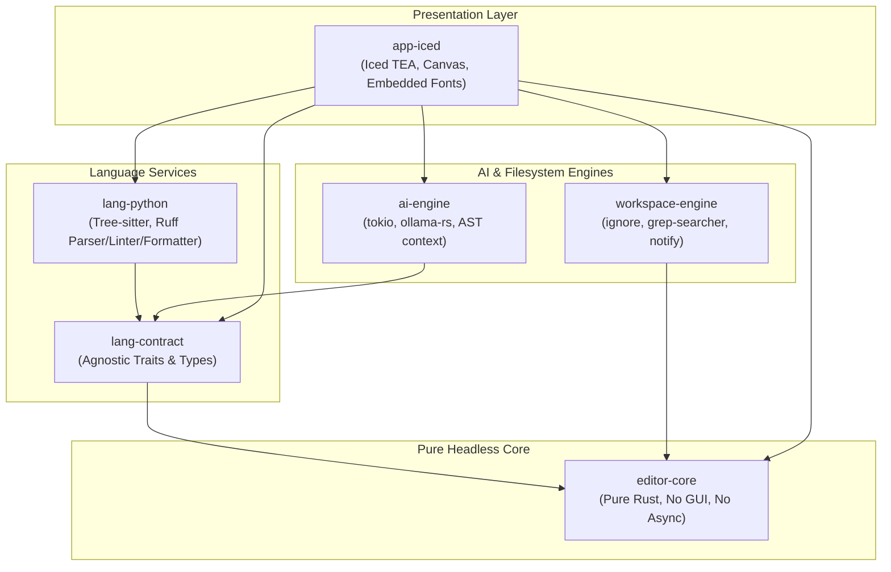

# Poom: Architecture & Engineering Blueprint

> **"The GUI must be a dumb, reactive projection of a headless state engine."**

Poom is a high-performance, polyglot-ready code editor engineered from day one using **Test-Driven Development (TDD)** and **pure headless core logic**, fronted by a reactive **Floem** user interface.

---

## 1. Core Architectural Tenets

1. **Strict GUI Decoupling**:
   - `editor-core` has zero dependencies on Floem, Winit, GPU rendering, or OS windowing.
   - 95%+ of editor logic (cursor physics, rope operations, viewport slicing, undo/redo trees, indentation rules) runs in standard synchronous `cargo test` harnesses in milliseconds.
2. **Granular Signal Reactivity**:
   - UI views do not re-render monolithically.
   - State is partitioned into fine-grained reactive signals (`RwSignal<T>`), ensuring that a cursor movement only updates the cursor overlay and status bar without touching the text buffer canvas or file tree.
3. **Sub-5ms 10k-Line Open SLA**:
   - Avoid monolithic file allocation. Stream chunks directly into a B-tree rope (`ropey`).
   - Virtualize lines strictly to the visible scroll window (typically 40–60 lines).
   - Bound syntax highlighting queries to the visible byte range.
   - Parse semantic ASTs (Ruff) in background workers and dispose of heavy node arenas immediately after extracting compact metadata.
4. **Clean Polyglot Extensibility**:
   - Language intelligence sits behind language-agnostic traits defined in `lang-contract`.
   - First-class mixed Python/C/Cython/Rust support with a **Virtual Stub Interceptor** for compiled binary `.pyd`/`.so` modules.

---

## 2. Multi-Crate Workspace Layout

```
Poom/
├── Cargo.toml                  # Workspace root manifest
├── docs/                       # Architecture, roadmaps, and milestone specifications
│   ├── README.md               # Master documentation index
│   ├── ARCHITECTURE.md         # Comprehensive architectural specification
│   └── milestones/             # Detailed milestone specifications
│       ├── 01_editor_core.md
│       ├── 02_language_contract_and_python.md
│       ├── 03_floem_virtual_viewport.md
│       ├── 04_diagnostics_and_formatting.md
│       ├── 05_ai_assistant_engine.md
│       └── 06_polyglot_extensions.md
├── crates/
│   ├── editor-core/            # Pure headless text buffer, cursors, undo/redo, viewport math
│   ├── lang-contract/          # Language-agnostic traits & shared data contracts
│   ├── lang-python/            # Tree-sitter + Ruff parser/linter/formatter
│   ├── ai-engine/              # AST context extractor & mockable Ollama streaming
│   ├── workspace-engine/       # File discovery, grep, virtualenv, notify watcher
│   └── app-iced/               # Iced desktop GUI shell & TEA bindings
└── src/                        # Main entrypoint delegating to app-iced
```

---

## 3. Crate Dependency Graph



---

## 4. Coordinate Systems & Indexing Rigor

To prevent multi-byte UTF-8 panics and off-by-one rendering errors, Poom enforces strongly typed coordinate newtypes in `editor-core`:

| Type | Definition | Invariant |
| --- | --- | --- |
| `ByteOffset(pub usize)` | 0-indexed byte position in UTF-8 buffer | Must always align on a valid UTF-8 code point boundary. |
| `CharIndex(pub usize)` | 0-indexed Unicode scalar position | Used by `ropey` for character-based random access. |
| `LineIndex(pub usize)` | 0-indexed buffer line number | 0 to `rope.len_lines() - 1`. |
| `ColumnIndex(pub usize)` | 0-indexed grapheme cluster offset within a line | Grapheme-cluster aware for multi-byte/emoji cursor movement. |
| `Utf16CodeUnitOffset(pub usize)` | UTF-16 code unit offset | LSP compatibility mapping for external language servers. |
| `PixelPoint { x: f64, y: f64 }` | Visual coordinate relative to editor canvas | Handled strictly in `app-iced`. |

---

## 5. Threading & Reactivity Model

- **Main / GUI Thread**:
  - Runs Iced event loop and executes pure-function rendering via `view()`.
  - Dispatches serializable `EditorCommand` events through `update(&mut self, message)`.
  - In-memory embedded TrueType fonts (`fonts.rs`) bypass OS registry scans and system font resolution issues completely.
- **Background Async Tokio Pool & Subscriptions**:
  - Offloads heavy IO: file loading, regex search (`workspace-engine`), Ruff AST parsing & linting (`lang-python`), and Ollama streaming (`ai-engine`).
  - Emits streaming items back to `update()` via native Iced `Task::stream` and `Subscription`.

---

## 6. Performance & Memory Budget (SLAs)

| Metric | Target SLA | Verification Technique |
| --- | --- | --- |
| **10k-Line File Open** | **< 5 ms** | Criterion / test benchmark measuring chunked rope load + visible line slice. |
| **Keystroke-to-Render Latency** | **< 16 ms** (60-120 FPS) | Viewport-only redraw: only dirty visible lines shaped via `cosmic-text`. |
| **Full Lint Pass (10k lines)** | **< 20 ms** (background) | Background Tokio worker with `ruff_linter`, 0ms UI blocking. |
| **Application RSS Memory** | **50 MB – 120 MB** | Ephemeral AST arena drops, hard LRU cap on glyph atlas textures. |
