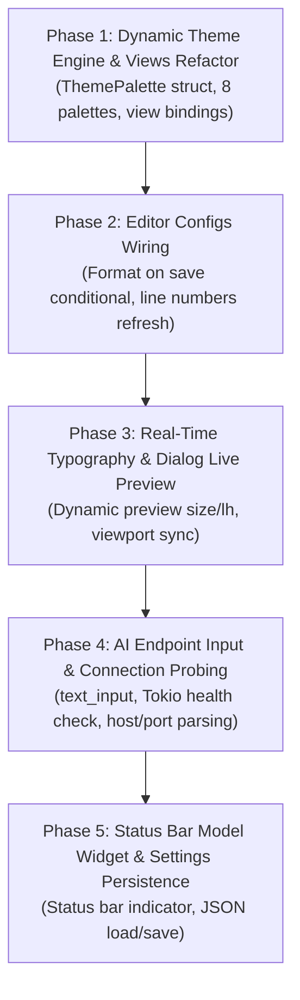

# Lide IDE: Settings System Architecture & Real-Time Wiring Plan

> **Document Status**: Architectural Blueprint & Implementation Specification  
> **Target Crates**: `crates/app-iced`, `crates/ai-engine`, `crates/editor-core`  
> **Author**: Antigravity Pair Programmer & Systems Engineer  
> **Date**: October 2026  

---

## 1. Executive Summary & Problem Statement

An audit of the Lide IDE settings dialog revealed that while UI buttons mutate in-memory fields on `LideApp`, the majority of features are **disconnected visual mockups**:
1. **Themes & Color Modes**: All views statically import compile-time `const` colors from [`theme.rs`](file:///c:/RustProjects/Poomv1/Poom/crates/app-iced/src/theme.rs) (One Dark Pro). Toggling between Dark and Light or picking palettes (Dracula, Nord, Solarized) changes zero colors in the application shell.
2. **AI Server Endpoint & Health**: The endpoint field and "Connected" badge are static strings with no `text_input` or connection probing, and `TriggerAiTask` hardcodes `OllamaStreamingClient::default()`.
3. **Format on Save**: [`SaveActiveFile`](file:///c:/RustProjects/Poomv1/Poom/crates/app-iced/src/lib.rs#L528) formats unconditionally in memory without checking `self.format_on_save_enabled`.
4. **Font Sizing & Live Preview**: Changing font sizes does not update the preview box in [`render_fonts_detail`](file:///c:/RustProjects/Poomv1/Poom/crates/app-iced/src/views/settings_dialog.rs#L298) because its font size is hardcoded to `12`, and `SetFontSize` fails to trigger viewport virtualization recalculations.
5. **AI Model Selection**: Selection updates state, but feedback is invisible unless the right-hand AI pane is already expanded.

This document outlines the **end-to-end engineering blueprint** to turn every setting into a **real-time, reactive capability** that adheres to The Elm Architecture (TEA), sub-millisecond SLAs, and zero-flicker rendering.

---

## 2. Architectural Blueprint & Target State

```
 ┌────────────────────────────────────────────────────────────────────────┐
 │                              LideApp State                             │
 │  - theme: ThemePalette (Active dynamic palette)                       │
 │  - theme_mode: ThemeMode (Dark | Light)                                │
 │  - active_theme_name: String ("One Dark Pro", "Nord Deep", etc.)       │
 │  - editor_font_size: f32 (8.0..32.0 px)                                │
 │  - line_height_px: f64 (14.0..48.0 px)                                 │
 │  - format_on_save_enabled: bool                                        │
 │  - line_numbers_enabled: bool                                          │
 │  - ai_endpoint: String ("http://localhost:11434")                      │
 │  - ai_connection_status: ConnectionStatus (Connected|Testing|Failed)   │
 │  - ai_model_name: String ("qwen2.5-coder:7b", etc.)                   │
 └─────────────┬────────────────────────────────────────────┬─────────────┘
               │                                            │
       update(command)                              view(&self)
               │                                            │
 ┌─────────────▼────────────────────────┐    ┌──────────────▼─────────────┐
 │ Deterministic State Transitions      │    │ Pure Reactive Views        │
 │ - SetTheme / SetThemeMode            │    │ - Views pass &ThemePalette │
 │ - SetFontSize / SetLineHeight        │    │ - Editor rows use font_size│
 │ - ToggleFormatOnSave                 │    │ - Status bar shows model   │
 │ - SetAiEndpoint / ProbeConnection    │    │ - In-dialog Live Previews  │
 │ - SaveSettingsToDisk (JSON/TOML)     │    │   react instantaneously    │
 └──────────────────────────────────────┘    └────────────────────────────┘
```

---

## 3. Detailed Component Implementation Specs

### 3.1. Dynamic Theme System (`crates/app-iced/src/theme.rs`)

#### Current Limitation
[`crates/app-iced/src/theme.rs`](file:///c:/RustProjects/Poomv1/Poom/crates/app-iced/src/theme.rs) contains compile-time `pub const BG_APP: Color = ...;`. Views cannot respond to user selection.

#### Proposed Design
1. **Define `ThemePalette` Struct**:
   ```rust
   #[derive(Debug, Clone, PartialEq)]
   pub struct ThemePalette {
       pub name: String,
       pub mode: ThemeMode,
       // Surfaces
       pub bg_app: Color,
       pub bg_editor: Color,
       pub bg_sidebar: Color,
       pub bg_toolbar: Color,
       pub bg_status_bar: Color,
       pub bg_active_row: Color,
       pub bg_card: Color,
       pub bg_dropdown: Color,
       // Borders
       pub border_subtle: Color,
       pub border_focused: Color,
       // Typography & Accents
       pub text_primary: Color,
       pub text_muted: Color,
       pub text_accent: Color,
       // Syntax Highlighting Tokens
       pub syntax_keyword: Color,
       pub syntax_function: Color,
       pub syntax_class: Color,
       pub syntax_decorator: Color,
       pub syntax_string: Color,
       pub syntax_number: Color,
       pub syntax_comment: Color,
       pub syntax_operator: Color,
       pub syntax_parameter: Color,
       pub syntax_builtin: Color,
       // Status Badges
       pub badge_error: Color,
       pub badge_warning: Color,
       pub badge_info: Color,
       pub badge_success: Color,
   }
   ```
2. **Preset Registry**:
   Implement standard themes with zero external dependencies:
   - **Dark Themes**:
     - *One Dark Pro* (default IDE dark palette)
     - *Dracula Dark* (`#282a36` background, `#bd93f9` purple accents, `#50fa7b` strings)
     - *Nord Deep* (`#2e3440` arctic dark, `#88c0d0` frost blue, `#ebcb8b` classes)
     - *GitHub Dark* (`#0d1117` canvas, `#58a6ff` link accent, `#7ee787` strings)
   - **Light Themes**:
     - *One Light* (default IDE light palette, `#fafafa` background, `#4078f2` functions)
     - *GitHub Light* (`#ffffff` canvas, `#24292f` primary text, `#0969da` accents)
     - *Solarized Light* (`#fdf6e3` base, `#268bd2` blue, `#859900` green)
     - *Quiet Light* (`#f5f5f5` muted background, `#7a3e9d` keywords)
3. **Palette Resolver**:
   ```rust
   impl ThemePalette {
       pub fn resolve(name: &str, mode: ThemeMode) -> Self;
       pub fn token_color(&self, token: Option<HighlightToken>) -> Color;
   }
   ```
4. **Wiring into `LideApp`**:
   - Add `pub current_theme: ThemePalette` to `LideApp`.
   - In `LideApp::new()`, initialize `current_theme` via `ThemePalette::resolve("One Dark Pro", ThemeMode::Dark)`.
   - In `EditorCommand::SetTheme(name)` and `EditorCommand::SetThemeMode(mode)`, update `self.current_theme = ThemePalette::resolve(&self.active_theme_name, self.theme_mode)`.
5. **View Updates**:
   - Update `render_app(app: &LideApp)` to pass `&app.current_theme` to:
     - `render_toolbar(app, theme)`
     - `render_editor(app, theme)`
     - `render_sidebar(app, theme)`
     - `render_status_bar(app, theme)`
     - `render_search_panel(app, theme)`
     - `render_pytest_panel(app, theme)`
     - `render_ai_pane(app, theme)`
     - `render_settings_dialog(app, theme)`
   - Deprecate static `const` usage across views in favor of dynamic theme tokens.

---

### 3.2. Real-Time Typography & Live Preview (`crates/app-iced/src/views/settings_dialog.rs`)

#### Current Limitation
- Preview font size in the Fonts settings tab is hardcoded:
  ```rust
  text("def quick_sort(arr: list[int]) -> list[int]:").size(12)
  ```
- `SetFontSize` does not call `refresh_visible_viewport()`, meaning the editor's virtualized row calculations are not synchronized immediately upon resizing.

#### Proposed Design
1. **Dynamic Font Size & Line Height in Preview**:
   ```rust
   // In render_fonts_detail:
   let preview_sz = app.editor_font_size.clamp(10.0, 20.0);
   let preview_lh = app.line_height_px.clamp(14.0, 32.0);
   let theme = &app.current_theme;
   let preview_font = resolve_font_by_name(&app.editor_font);

   let preview_box = container(
       column![
           text("def quick_sort(arr: list[int]) -> list[int]:")
               .size(preview_sz)
               .font(preview_font)
               .color(theme.syntax_function),
           text("    \"\"\"Sub-millisecond AST benchmark.\"\"\"")
               .size(preview_sz)
               .font(preview_font)
               .color(theme.syntax_comment),
           text("    if len(arr) <= 1:")
               .size(preview_sz)
               .font(preview_font)
               .color(theme.syntax_keyword),
           text("        return arr")
               .size(preview_sz)
               .font(preview_font)
               .color(theme.text_primary),
           text("    pivot = arr[len(arr) // 2]")
               .size(preview_sz)
               .font(preview_font)
               .color(theme.text_primary),
           text("    left = [x for x in arr if x < pivot]")
               .size(preview_sz)
               .font(preview_font)
               .color(theme.syntax_string),
           text("    return quick_sort(left) + [pivot]")
               .size(preview_sz)
               .font(preview_font)
               .color(theme.text_accent),
       ]
       .spacing((preview_lh as f32 - preview_sz).max(2.0))
       .padding(14),
   )
   ```
2. **Synchronized Viewport Recalculation**:
   In `crates/app-iced/src/lib.rs`:
   ```rust
   EditorCommand::SetFontSize(sz) => {
       self.editor_font_size = sz.clamp(8.0, 32.0);
       self.line_height_px = (self.editor_font_size * 1.5).round().clamp(14.0, 48.0);
       self.refresh_visible_viewport();
       Task::none()
   }
   ```

---

### 3.3. Editor Configurations: Format on Save & Line Numbers

#### Current Limitation
- In `SaveActiveFile`, formatting happens unconditionally:
  ```rust
  EditorCommand::SaveActiveFile => {
      self.format_buffer_in_memory(); // ALWAYS RUNS!
      ...
  }
  ```
- Line numbers toggle works in memory, but the user has no visual confirmation inside the Settings modal.

#### Proposed Design
1. **Respect `format_on_save_enabled`**:
   In `crates/app-iced/src/lib.rs`:
   ```rust
   EditorCommand::SaveActiveFile => {
       if self.format_on_save_enabled {
           self.format_buffer_in_memory();
       }
       if let Some(target_path) = self.active_file_path.clone() {
           ...
       }
       self.is_dirty = false;
       self.run_ephemeral_analysis_internal();
       Task::none()
   }
   ```
2. **Instant Line Number Refresh**:
   In `EditorCommand::ToggleLineNumbers`:
   ```rust
   EditorCommand::ToggleLineNumbers => {
       self.line_numbers_enabled = !self.line_numbers_enabled;
       self.refresh_visible_viewport();
       Task::none()
   }
   ```
3. **Interactive Toggle Cards with Live Mini-Previews**:
   In `render_configs_detail`, add an interactive sample line number gutter demonstration showing numbers switching between `1 | 2 | 3` and clean border spacing.

---

### 3.4. AI Assistant Endpoint Configuration & Live Health Check

#### Current Limitation
- `app.ai_endpoint` cannot be edited (no input widget).
- "Connected" badge is hardcoded green.
- `TriggerAiTask` hardcodes `OllamaStreamingClient::default()` (`localhost:11434`), ignoring `app.ai_endpoint`.

#### Proposed Design
1. **Configurable Endpoint & Health State**:
   ```rust
   #[derive(Debug, Clone, Copy, PartialEq, Eq)]
   pub enum AiConnectionStatus {
       Disconnected,
       Checking,
       Connected,
       Error,
   }
   ```
   Add to `LideApp`:
   ```rust
   pub ai_endpoint: String,
   pub ai_status: AiConnectionStatus,
   pub ai_status_message: Option<String>,
   ```
2. **Interactive `text_input` in AI Settings**:
   Replace static endpoint card with:
   - `text_input("http://localhost:11434", &app.ai_endpoint).on_input(EditorCommand::SetAiEndpoint)`
   - "Test Connection" button dispatching `EditorCommand::ProbeAiConnection`
   - Real-time connection badge that shows spinning/amber when `Checking`, green when `Connected`, red when `Disconnected`.
3. **Asynchronous Connection Probe (Non-blocking Tokio Task)**:
   ```rust
   EditorCommand::ProbeAiConnection => {
       self.ai_status = AiConnectionStatus::Checking;
       let endpoint = self.ai_endpoint.clone();
       Task::perform(
           async move {
               let url = format!("{}/api/tags", endpoint.trim_end_matches('/'));
               match reqwest::Client::builder()
                   .timeout(std::time::Duration::from_millis(1500))
                   .build()
               {
                   Ok(client) => match client.get(&url).send().await {
                       Ok(res) if res.status().is_success() => Ok(()),
                       Ok(res) => Err(format!("HTTP {}", res.status())),
                       Err(e) => Err(e.to_string()),
                   },
                   Err(e) => Err(e.to_string()),
               }
           },
           |res| match res {
               Ok(_) => EditorCommand::AiConnectionResult(true, None),
               Err(err) => EditorCommand::AiConnectionResult(false, Some(err)),
           },
       )
   }
   ```
4. **Dynamic Client Instantiation**:
   Update `prepare_ai_task_request` / `TriggerAiTask` to parse `self.ai_endpoint`:
   ```rust
   let (host, port) = parse_host_port(&self.ai_endpoint);
   let client = OllamaStreamingClient::new(&host, port);
   let ai_engine = AiEngine::new(client);
   ```

---

### 3.5. AI Models Tab: Real-Time Visual Feedback & Status Bar Presence

#### Current Limitation
Selecting a model updates `self.ai_model_name`, but unless the right drawer is open, no UI changes are visible.

#### Proposed Design
1. **Status Bar Model Indicator**:
   In [`crates/app-iced/src/views/status_bar.rs`](file:///c:/RustProjects/Poomv1/Poom/crates/app-iced/src/views/status_bar.rs), add an AI model pill button:
   - Displays `icon(Icon::Cpu)` + `text(&app.ai_model_name)`.
   - Clicking it directly opens `EditorCommand::OpenSettingsDialog(SettingsTab::AiModels)`.
2. **Ephemeral Toast Notification**:
   When `SetAiModel(model)` is selected, show an ephemeral toast notification in the status bar (e.g. `Switched active AI model to qwen2.5-coder:7b`).
3. **Live Ollama Model Enumeration**:
   When connection probe succeeds, automatically populate the list of installed Ollama models in addition to the curated defaults.

---

### 3.6. Persistent Configuration Storage (`~/.lide/settings.json`)

To ensure settings persist across restarts:
1. **Schema**:
   ```rust
   #[derive(Debug, Clone, Serialize, Deserialize)]
   pub struct LideSettings {
       pub theme_name: String,
       pub theme_mode: String,
       pub editor_font_size: f32,
       pub line_height_px: f64,
       pub format_on_save_enabled: bool,
       pub line_numbers_enabled: bool,
       pub ai_endpoint: String,
       pub ai_model_name: String,
       pub editor_font: String,
   }
   ```
2. **Load on Startup**: In `LideApp::new()`, load `~/.lide/settings.json` if present; fallback to default values otherwise.
3. **Debounced Auto-Save**: When any setting changes, dispatch a background task to write to `.lide/settings.json` atomically via temp file rename.

---

## 4. Red-Green-Refactor TDD Test Plan

Following Lide's TDD principles, all features must be verified via headless unit and integration tests without a display server:

| Test Harness File | Test Case | Expected Behavior |
| :--- | :--- | :--- |
| `tests/theme_system_tdd.rs` | `test_theme_palette_resolution` | `ThemePalette::resolve("Nord Deep", Dark)` returns expected hex colors for all syntax tokens. |
| `tests/theme_system_tdd.rs` | `test_theme_mode_switch` | Switching between Dark and Light mode automatically updates `app.current_theme`. |
| `tests/editor_settings_tdd.rs` | `test_format_on_save_toggle` | When `format_on_save_enabled = false`, saving a Python buffer with unformatted whitespace preserves raw whitespace. |
| `tests/editor_settings_tdd.rs` | `test_font_size_viewport_refresh` | `SetFontSize(24.0)` clamps between 8 and 32 and updates `app.line_height_px` and visible lines count. |
| `tests/ai_settings_tdd.rs` | `test_custom_endpoint_parsing` | `SetAiEndpoint("http://192.168.1.100:11434")` correctly configures client host and port. |
| `tests/ai_settings_tdd.rs` | `test_ai_model_status_bar_sync` | `SetAiModel("deepseek-coder:1.3b")` propagates to status bar state and prompt requests. |
| `tests/settings_persistence_tdd.rs` | `test_settings_roundtrip_serialization` | Serialization and deserialization to JSON produces identical `LideSettings` struct. |

---

## 5. Implementation Roadmap (Phases)



### Phase 1: Dynamic Theme Engine & View Wiring
- Create `crates/app-iced/src/theme/palettes.rs` with `ThemePalette` and the 8 color schemes.
- Add `current_theme` to `LideApp` and update `SetTheme` / `SetThemeMode`.
- Refactor views (`editor.rs`, `toolbar.rs`, `sidebar.rs`, `status_bar.rs`, `settings_dialog.rs`) to consume `&ThemePalette`.

### Phase 2: Editor Configurations Wiring
- Update [`SaveActiveFile`](file:///c:/RustProjects/Poomv1/Poom/crates/app-iced/src/lib.rs#L528) to conditionally format only when `format_on_save_enabled == true`.
- Trigger `refresh_visible_viewport()` when toggling line numbers.
- Add live mini-preview to the Configs tab.

### Phase 3: Real-Time Typography & Dialog Live Preview
- Bind `editor_font_size`, `line_height_px`, and `current_theme` into `render_fonts_detail`'s live syntax preview box.
- Trigger `refresh_visible_viewport()` on `SetFontSize`.

### Phase 4: AI Endpoint Input & Live Connection Probing
- Add `text_input` in `render_ai_detail`.
- Add `ProbeAiConnection` command with async Tokio probe to `http://<host>:<port>/api/tags`.
- Wire `ai_endpoint` into `OllamaStreamingClient::new(host, port)`.

### Phase 5: Status Bar Model Widget & JSON Persistence
- Add AI model chip to the status bar with instant click-to-settings navigation.
- Implement `LideSettings` with load on startup and debounced save on edit.
