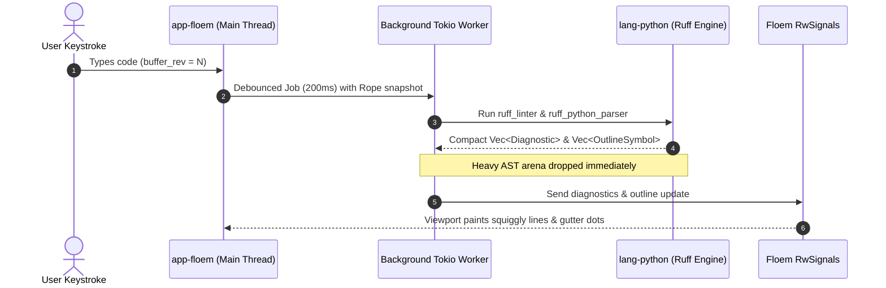

# Milestone 4: Inline Ruff Diagnostics & Formatting on Save (`workspace-engine` + `app-floem`)

> **Goal**: Connect the background Ruff linter pipeline to Floem's reactive UI (gutter indicators, squiggly underlines, bottom "Problems" panel) and implement atomic Format-on-Save with cursor position preservation. Build the initial `workspace-engine` crate for fast directory traversal and file watching.

---

## 1. Scope & Crate Responsibility

### 1.1 `crates/workspace-engine`
- **Responsibility**: Fast directory indexing, `.gitignore` traversal, file watching, and virtual environment discovery.
- **Dependencies**:
  - `ignore` (Fast ripgrep-based directory walker respecting `.gitignore`)
  - `notify` (Cross-platform filesystem event watcher)
  - `tempfile` (Dev dependency for testing directory trees)

### 1.2 `crates/app-floem` (Integration)
- Wire async Tokio workers to Floem reactive signals via non-blocking channels.
- Render diagnostic squiggles, gutter icons, problem list view, and format-on-save trigger.

---

## 2. Core Architecture & Diagnostics Pipeline



---

## 3. Required Implementation Tasks

### Task 4.1: Asynchronous Debounced Linting Pipeline
- Implement background worker using `tokio::spawn` or dedicated thread.
- On buffer edit (`buffer_rev` increment):
  - Start or reset a 200ms debounce timer.
  - Clone a lightweight `Rope` snapshot (instant $O(1)$ copy-on-write clone in `ropey`).
  - Pass snapshot to `lang-python`'s `lint()` and `extract_outline()`.
  - Check cancellation token: if a newer edit arrived during linting, discard results.
  - Dispatch fresh `Vec<Diagnostic>` and `Vec<OutlineSymbol>` to main thread signals.

### Task 4.2: Visual Diagnostics (Gutter, Squiggles, Hover)
- **Gutter Indicators**:
  - Render colored dots / icons on lines containing diagnostics (Red = Error, Yellow = Warning, Blue = Info).
- **Inline Squiggly Underlines**:
  - Compute pixel bounding box of diagnostic `(ByteOffset, ByteOffset)`.
  - Draw wave or dotted line beneath tokens on the canvas.
- **Hover Tooltip**:
  - When mouse rests over a diagnostic span, render a lightweight floating popup with the error code (e.g. `[F401]`) and explanation message.
- **Problems Drawer / Panel**:
  - Collapsible bottom panel listing all diagnostics grouped by file, line, and severity.
  - Double-clicking a problem jumps the cursor directly to the offending line and column.

### Task 4.3: Format on Save with Cursor Compensation
- On `Ctrl+S` / `Cmd+S`:
  1. Call `lang_python.format(&rope, None)`.
  2. Compute a minimal diff between old rope and formatted string using Myers diff or line diff.
  3. Apply minimal edits to `editor-core` so that undo history remains clean.
  4. **Cursor Compensation**: Translate active cursor positions to new line/column coordinates to prevent the cursor from jumping to line 1 or jumping randomly.
  5. Atomically flush buffer to disk.
  6. Clear `is_dirty` signal.

### Task 4.4: Workspace Engine Discovery & Watcher
- Directory tree scanner using `ignore::WalkBuilder`:
  - Rapidly list files in project folder, filtering out `.git`, `__pycache__`, `.pytest_cache`, `target/`, and `node_modules`.
- Virtual environment detector:
  - Detect `.venv`, `venv`, or `conda` environments in workspace root.
  - Extract Python binary version string for the status bar.
- File change notification (`notify` crate):
  - Detect when files are modified externally (e.g. `git pull`) and notify user or reload buffer.

---

## 4. Test-Driven Development (TDD) Plan

### Tier 4.1: Diagnostic Pipeline Cancellation & Debounce Test
- Write a Tokio test in `lang-python` / `workspace-engine`:
  - Simulate typing 10 characters rapidly (firing 10 lint requests in 50ms).
  - Verify that only the final 10th request completes a full lint pass and that intermediate runs are cancelled.

### Tier 4.2: Format on Save Cursor Preservation Test
- Create a buffer with unformatted Python:
  ```python
  x = [1, 2,   3,
       4,5]
  ```
- Place cursor inside `[1, 2, | 3]`.
- Trigger `format()`.
- Assert resulting text matches Ruff standard formatting.
- Assert cursor remains adjacent to character `2`, rather than resetting to line 1.

### Tier 4.3: Workspace Indexing Fixture (`tempfile`)
- Generate a temporary directory structure with 1,000 files, including nested `.gitignore` files and a `.venv` directory.
- Run `workspace-engine` tree scanner.
- Assert scan finishes in **< 10 ms** and properly excludes ignored virtualenv files.

---

## 5. Acceptance Criteria Checklist

- [ ] Typing Python code with syntax or lint errors updates gutter and squiggles within 300ms without freezing the UI.
- [ ] Saving an unformatted Python file (`Ctrl+S`) formats it with Ruff in < 5ms and keeps the cursor at the user's focus point.
- [ ] Problems panel displays current diagnostics and clicking an item focuses the line in the editor.
- [ ] Workspace tree traverses 5,000 files in under 20ms and ignores `.git` and `__pycache__`.
- [ ] All tests pass via `cargo test --workspace`.
