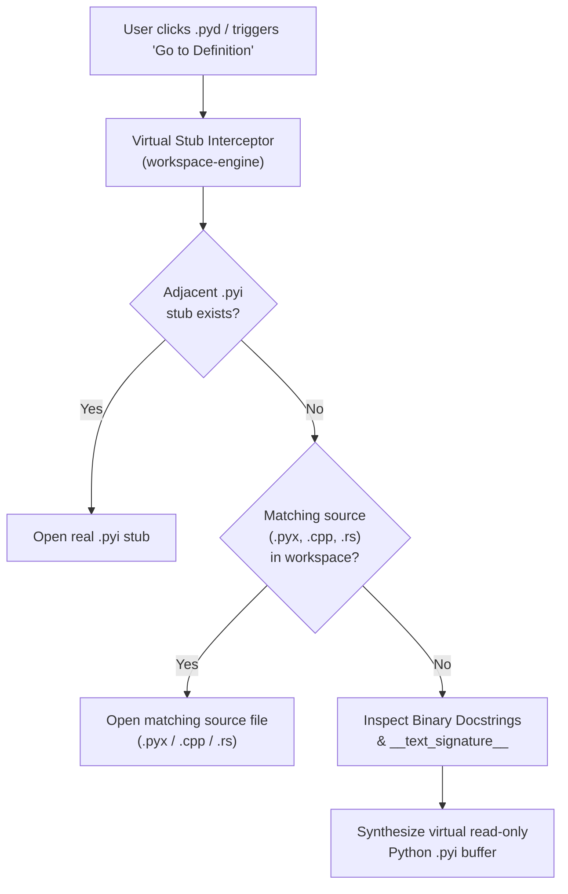

# Milestone 6: Polyglot Extensions & Binary Stubs (C/C++, Cython, PyO3, `.pyd`)

> **Goal**: Extend Poom's architecture to seamlessly support mixed-language Python projects (Cython `.pyx`/`.pxd`, C/C++ extensions, and Rust `PyO3`), featuring a Virtual Stub Interceptor that transforms compiled binary `.pyd`/`.so` modules into navigable, readable code views without binary gibberish.

---

## 1. Scope & Crate Responsibility

- **Crates Involved**:
  - `crates/lang-contract` (Language traits & stub resolver contracts)
  - `crates/workspace-engine` (Binary file inspection & virtual stub interceptor)
  - `crates/lang-cython` (Future plugin implementing `lang-contract` via `tree-sitter-cython`)
  - `crates/lang-lsp` (Async LSP adapter for `clangd` and `rust-analyzer`)

---

## 2. Core Architecture & Virtual Stub Interceptor

Mixed Python/C/Rust repositories often import binary modules (`.pyd` on Windows, `.so` on Linux/macOS). Opening a binary in an editor displays unreadable hex/gibberish, and "Go to Definition" fails.

Poom resolves this with a **Three-Tier Virtual Stub Pipeline**:



---

## 3. Required Implementation Tasks

### Task 3.1: Virtual Stub Interceptor (`workspace-engine`)
- Intercept file open requests when extension is `.pyd`, `.so`, or `.dylib`.
- Search precedence:
  1. Look for `<module_name>.pyi` in same folder or typing stub path.
  2. Search project for `<module_name>.pyx` or `<module_name>.pxd` (Cython).
  3. Search project for PyO3 `#[pyfunction]` or `#[pymodule]` in `src/*.rs`.
  4. Search project for `pybind11` or `nanobind` definitions in `src/*.cpp`.
  5. Fallback: Run isolated Python subprocess executing `inspect.signature` / `pydoc` and synthesize a clean, typed stub file in memory.

### Task 3.2: Cython Syntax & Cross-Referencing (`.pyx` / `.pxd`)
- Add `tree-sitter-cython` grammar.
- Support Cython keywords (`cdef`, `cpdef`, `cimport`, `nogil`, `bint`).
- Link `.pxd` header declarations directly to `.pyx` implementations on `F12` / "Go to Definition".

### Task 3.3: Async LSP Adapter for C/C++ & Rust
- Create `LspLanguageClient` implementing `LanguageService`:
  - Launch and communicate with `clangd` (for C/C++) and `rust-analyzer` (for PyO3/Rust) via JSON-RPC over stdin/stdout.
  - Map LSP `Position` and `Range` (UTF-16 code units) to Poom's `ByteOffset` and `LineIndex`.
  - Non-blocking: editor UI continues typing at 120 FPS while LSP queries resolve asynchronously.

---

## 4. Test-Driven Development (TDD) Plan

### Tier 6.1: Virtual Stub Resolver Test Fixture
- Create a temporary workspace containing:
  - `fast_math.so` (dummy binary)
  - `fast_math.pyx` (Cython source)
- Call `workspace.resolve_open_target("fast_math.so")`.
- Assert resolver redirects buffer to `fast_math.pyx` rather than loading binary bytes.

### Tier 6.2: Synthesized Stub Test
- Feed a mock metadata payload (docstrings + parameter signatures):
  ```
  add(a: int, b: int) -> int: Adds two integers.
  ```
- Generate synthesized stub buffer.
- Assert output parses cleanly under Ruff parser as a valid `.pyi` stub with docstrings.

---

## 5. Acceptance Criteria Checklist

- [ ] Attempting to open a `.pyd` or `.so` file never renders binary gibberish in the editor buffer.
- [ ] Cython `.pyx` and `.pxd` files feature full syntax highlighting and structure outlines.
- [ ] Jump-to-definition works between Cython `.pxd` declarations and `.pyx` implementations.
- [ ] External LSP servers (`clangd`, `rust-analyzer`) run in the background without causing frame drops in Floem.
